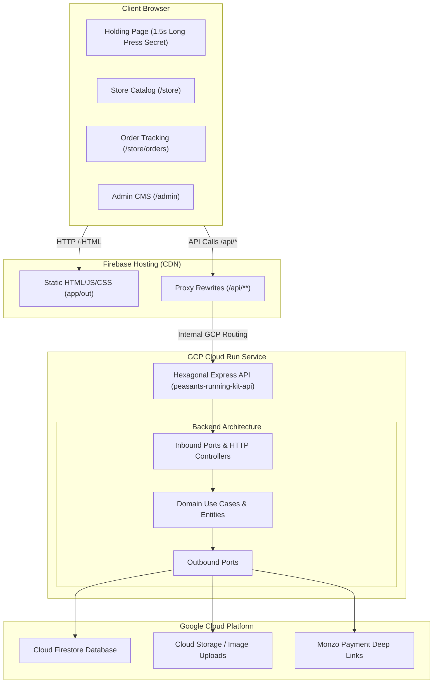

# Peasants Running Kit 🏃‍♂️📦

Full-stack holding page, e-commerce store, and administrative CMS for **Peasants Running Kit** (Peasants Revolt Running Club), hosted at [`peasants-running-kit.store`](https://peasants-running-kit.store).

Built with a **Next.js 14 Frontend** statically exported to Firebase Hosting, a **Node.js Express TypeScript Backend API** adhering strictly to **Hexagonal Architecture** deployed on GCP Cloud Run, **Cloud Firestore** document database, and **Terraform Infrastructure as Code**.

---

## 🌟 Key Features

- **Interactive Holding Page (`/`)**: Brand holding page with background color `rgb(202, 88, 46)`. Long-pressing (1.5 seconds) the central logo animates an SVG progress ring that unlocks access to the secret beta store catalog.
- **Storefront Catalog (`/store`)**: Dynamic kit catalog supporting item browsing, size selection (XS–XXL), sticky shopping basket drawer, and instant order creation.
- **Monzo Payment Deep-Linking**: Orders generate a unique reference (`PRRC-XXXX`) and direct deep links to Monzo transfers (`https://monzo.me/peasantsrevolt/[amount]?d=PRRC-XXXX`).
- **User Order Tracking (`/store/orders`)**: Dedicated page allowing club members to look up order status, item breakdowns, and payment state.
- **Organiser Admin CMS (`/admin`)**: Organiser portal protected by authentication for CRUD management of products, image file uploads, and updating customer order payment/fulfillment statuses.
- **Hexagonal Architecture**: Strict separation of concern between Domain Entities, Inbound/Outbound Ports, Use Cases, Driving HTTP Controllers, and Driven Database/Storage Adapters.
- **Zero Hardcoded Backend URLs**: Firebase Hosting proxy rewrite (`/api/**` $\rightarrow$ Cloud Run API) enables zero hardcoded backend URLs in git and zero CORS issues.

---

## 🏗️ System Architecture



---

## 📁 Repository Structure

```text
peasants-running-kit/
├── app/                                  # Frontend Application (Next.js 14)
│   ├── public/                           # Assets (Club logo, images)
│   ├── src/
│   │   ├── app/                          # App Router pages (/, /store, /store/orders, /admin)
│   │   ├── components/                   # StoreHeader, components
│   │   └── lib/                          # API client (/api base routing)
│   ├── firebase.json                     # Hosting config with /api/** -> Cloud Run rewrite
│   └── next.config.js                    # Next.js static export output config
├── backend/                              # Hexagonal Architecture API (Node.js Express TypeScript)
│   ├── src/
│   │   ├── domain/
│   │   │   ├── entities/                 # Product, Order, Cart
│   │   │   ├── ports/inbound/            # Use Case Interfaces
│   │   │   ├── ports/outbound/           # Repository & Gateway Interfaces
│   │   │   └── usecases/                 # Business Logic Execution
│   │   ├── adapters/
│   │   │   ├── inbound/http/             # Express Controllers & Router (/api/*)
│   │   │   └── outbound/                 # Firestore, Monzo & Storage Adapters
│   │   ├── config/                       # Dependency Injection Container
│   │   └── server.ts                     # Express Server entrypoint (Port 8080)
│   ├── Dockerfile                        # Multi-arch Cloud Run container (linux/amd64)
│   └── package.json
├── infrastructure/                       # Infrastructure as Code (Terraform)
│   ├── main.tf                           # Cloud Run, Firebase Site, Web App, Auth, Artifact Registry
│   ├── variables.tf                      # GCP Project Variables
│   └── outputs.tf                        # Resource URIs and Build Commands
└── README.md
```

---

## 🛠️ Local Development Setup

### Prerequisites

- **Node.js**: `v20.x` or higher
- **Docker**: For local backend container testing
- **GCP CLI (`gcloud`) & Firebase CLI (`firebase-tools`)**
- **Terraform**: `>= 1.0.0`

### Running the Backend Locally

```bash
cd backend
npm install
npm run dev
# Server listens at http://localhost:8080/api/health
```

### Running the Frontend Locally

```bash
cd app
npm install
npm run dev
# App listens at http://localhost:3000
```

---

## 🚀 Deployment Guide

### 1. Provision Infrastructure via Terraform

```bash
cd infrastructure
terraform init
terraform plan
terraform apply
```

### 2. Build & Push Backend Container Image

Build the container image targeting `linux/amd64` architecture (required for Cloud Run execution):

```bash
docker build --pull --no-cache --platform linux/amd64 -t europe-west2-docker.pkg.dev/peasants-running-kit/peasants-running-kit/backend-api:latest backend
docker push europe-west2-docker.pkg.dev/peasants-running-kit/peasants-running-kit/backend-api:latest
```

*Alternative via Cloud Build:*
```bash
gcloud builds submit --tag europe-west2-docker.pkg.dev/peasants-running-kit/peasants-running-kit/backend-api:latest backend
```

### 3. Build & Deploy Frontend to Firebase Hosting

```bash
cd app
npm run build
npx -y firebase-tools@latest deploy --only hosting --project peasants-running-kit
```

---

## 🔒 Security & Environment Configuration

- **No Hardcoded Keys in Git**: Environment files (`.env`, `.env.local`) are strictly excluded via `.gitignore`.
- **Zero CORS Issues**: Frontend sends relative `/api/*` requests to Firebase Hosting, which proxies requests server-side to Cloud Run.
- **Firebase Authentication & Identity Platform**: Provisioned via Terraform (`google_identity_platform_config`).

---

## 📄 License

Internal project for **Peasants Revolt Running Club**. All rights reserved.
